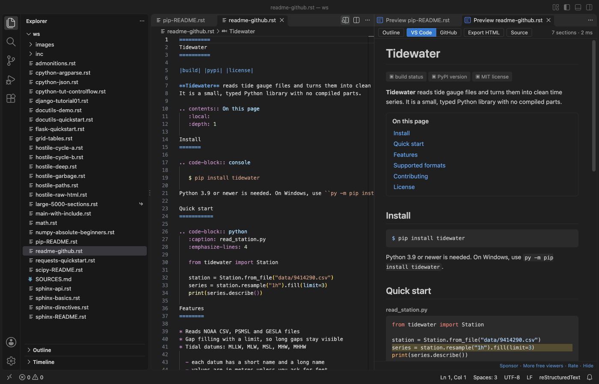
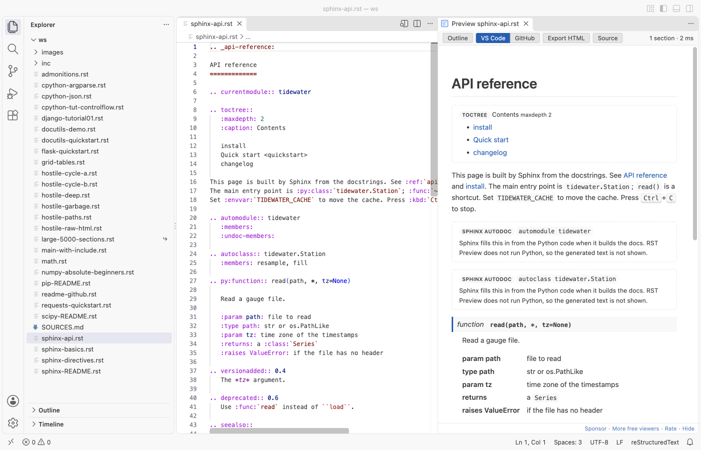
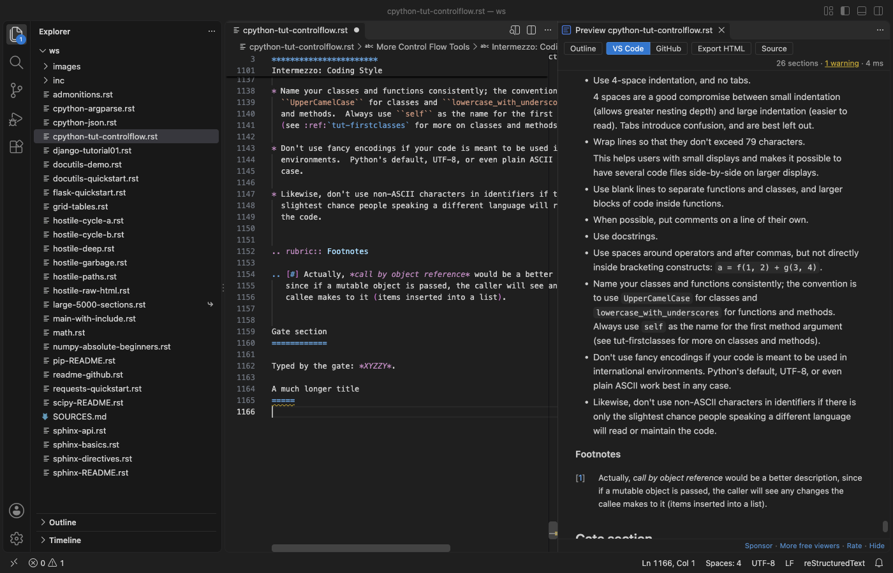
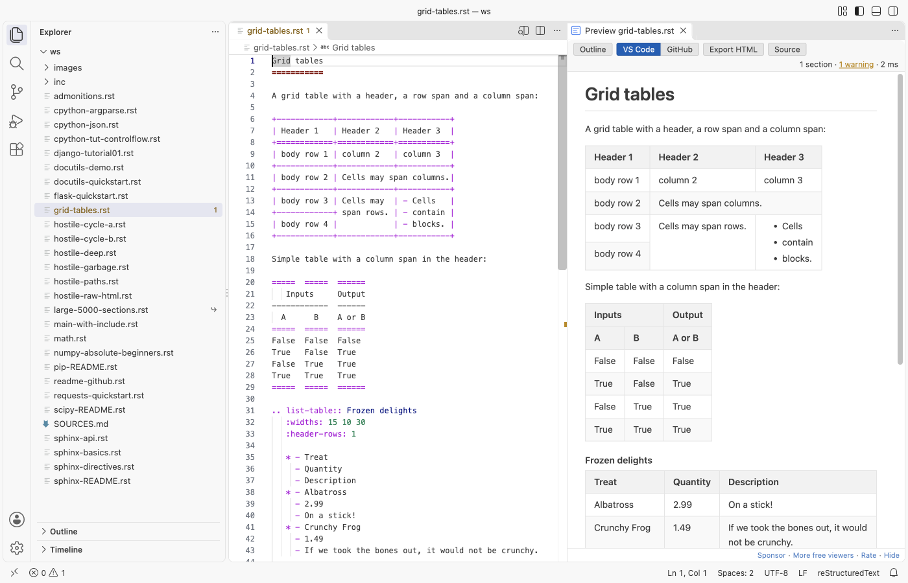
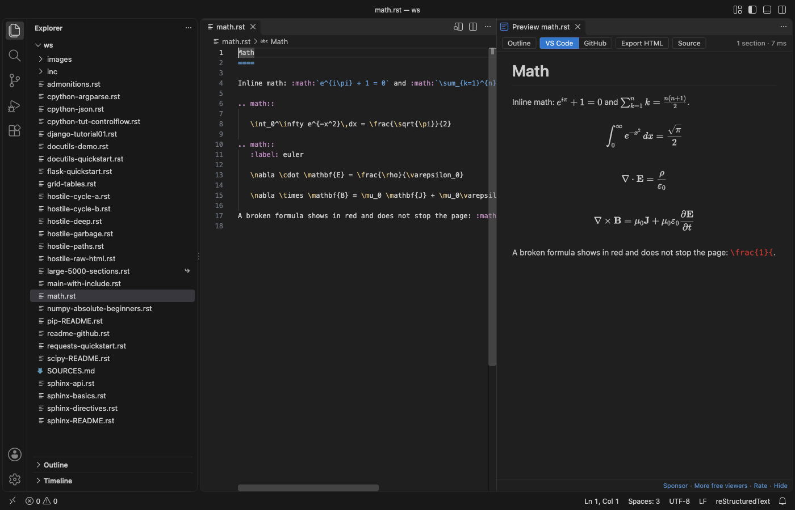
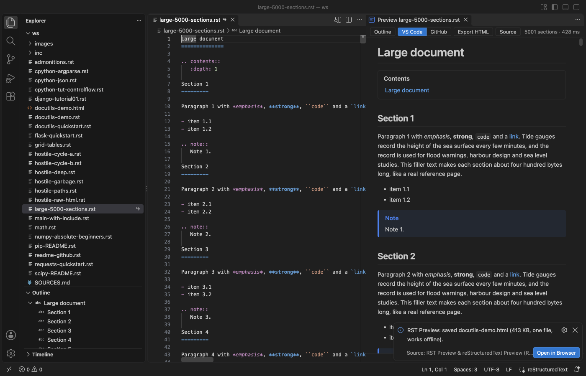
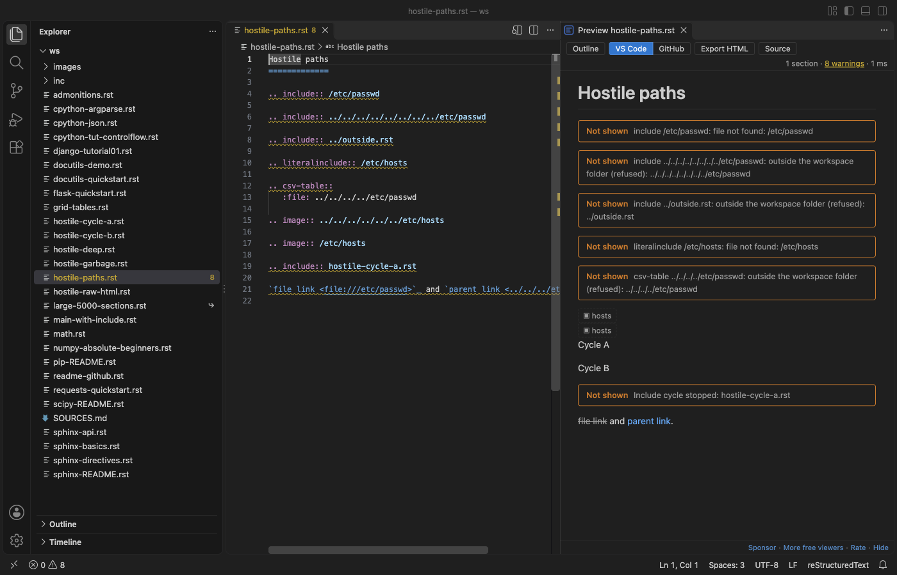

# RST Preview & reStructuredText Preview (RST Viewer, No Python)

Open a `.rst` file and see it rendered beside the editor, as you type. No Python, no Sphinx, no docutils, no `conf.py`. Free, no sign-in, works offline.

## Why this preview

- It opens with no setup. Other RST previews need Python with docutils or a full Sphinx project, and fail with an empty window when Python is missing or installed in a path with a space. RST Preview renders reStructuredText itself, inside VS Code.
- Lists, tables and directives look right: bullets, numbered lists (1, a, i, I), definition, field and option lists, grid tables with row and column spans, simple tables, `csv-table` and `list-table`, admonitions, footnotes, citations and substitutions.
- Sphinx files do not break it. `toctree`, `automodule` and other Sphinx directives show as labelled boxes, and roles such as `:ref:`, `:doc:` and `:py:func:` show as links or code, never as an error page.

## What it does

- Live preview that updates while you type and scrolls with the editor (both ways). Double-click the preview to jump to that line.
- Problems panel: a title underline that is too short, a link to a missing target, a broken table. The preview keeps the last good render when something goes wrong.
- Code blocks in color (`code-block`, `sourcecode`, `literalinclude`, doctest), with `:linenos:`, `:emphasize-lines:` and `:caption:`.
- Math with KaTeX: the `math` directive and the `:math:` role.
- Local pictures (`image`, `figure`, `|name| image::`), `include` of local files, `contents`, `sectnum`, `topic`, `sidebar`, `rubric`, `epigraph`, `parsed-literal`, `line-block`, `raw:: html` (cleaned: no scripts, no event handlers).
- Outline: the sections of the file in a side list, in the VS Code Outline view and in the breadcrumbs.
- Two looks: the colors of your VS Code theme, or the GitHub README look (light and dark).
- Export HTML: one file with the pictures, math fonts and code colors inside. It opens in any browser with no network.

## How to use

1. Open a `.rst` file.
2. Click the preview button at the top right of the editor, or press `Ctrl+K V` (`Cmd+K V` on a Mac). `Ctrl+Shift+V` opens the preview in place of the editor.
3. Use the Outline, VS Code / GitHub, Export HTML and Source buttons in the preview toolbar.

## Large files and safety

- Files up to 20 MB render at once (setting `rstPreview.maxFileMB`). A larger file shows a message and a Render anyway button instead of a frozen window. Only the changed parts of the page are redrawn while you type.
- The preview loads nothing from the network: remote pictures (for example badges) show as a small label. Links open in your browser only when you click them.
- `include`, `literalinclude`, `csv-table :file:` and pictures are read only from inside your workspace folder. A path such as `/etc/passwd` or `../../..` is refused, include cycles stop, and nesting stops after 5 levels.

## Settings

| Setting | Default | What it does |
|---|---|---|
| `rstPreview.style` | `vscode` | `vscode` or `github` look |
| `rstPreview.scrollSync` | `true` | Scroll the preview and the editor together |
| `rstPreview.updateDelayMs` | `250` | Wait after typing before the preview renders again |
| `rstPreview.maxFileMB` | `20` | Largest file that renders at once |
| `rstPreview.problems` | `warnings` | `warnings`, `all` or `off` for the Problems panel |
| `rstPreview.fontSize` | `0` | Font size in pixels (0 = 14 px) |
| `rstPreview.askForRating` | `true` | One rating request after a few days of use |
| `rstPreview.showSupportLinks` | `true` | Small Sponsor and More free viewers links at the bottom |

## Limits

- RST Preview is not Sphinx. It does not run `conf.py`, extensions or autodoc, so text that Sphinx makes from Python code is not shown, and `:ref:` to a label in another file shows as plain text.
- `raw` content other than HTML (LaTeX and so on) is not shown. `:file:` and `:url:` options of `raw` and `csv-table :url:` are not read.
- Some rare docutils features are missing: `header` and `footer`, the special layout of bibliographic fields (`:Address:` and others show as a plain field list), and custom roles beyond `.. role::` with a class.

## Support Zovo

Zovo extensions are free, with no ads and no tracking. They are made by [theluckystrike](https://github.com/theluckystrike) on GitHub. If this one saves you time, you can support the work:

- [Sponsor on GitHub](https://github.com/sponsors/theluckystrike)
- [Follow theluckystrike on GitHub](https://github.com/theluckystrike)

## More tools by Zovo

- [DOCX Viewer, Word Viewer & DOCX Preview (Dark Mode)](https://marketplace.visualstudio.com/items?itemName=zovo.docx-viewer-vscode) previews Word and ODT files with dark mode, an outline and search.
- [PDF Viewer & PDF Reader](https://marketplace.visualstudio.com/items?itemName=zovo.pdf-viewer-dark) reads PDFs with a real dark mode, search, an outline and thumbnails.
- [Graphviz Viewer & DOT Viewer (Live Preview)](https://marketplace.visualstudio.com/items?itemName=zovo.zovo-graphviz-preview) shows a live preview of DOT files and exports SVG or PNG.
- [Mermaid Viewer & Mermaid Preview](https://github.com/theluckystrike/mermaid-viewer-vscode) shows .mmd files and mermaid blocks in Markdown, offline, with SVG and PNG export.
- [Pickle Viewer & PKL Viewer (No Python)](https://marketplace.visualstudio.com/items?itemName=zovo.zovo-pickle-viewer) opens Python pickle files without Python and never runs their code.

See [all Zovo extensions on the Marketplace](https://marketplace.visualstudio.com/publishers/zovo).
